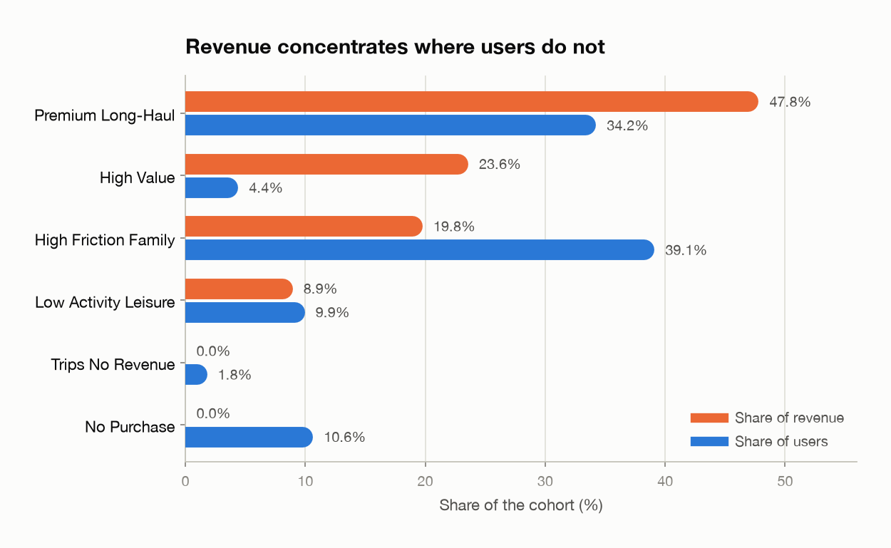
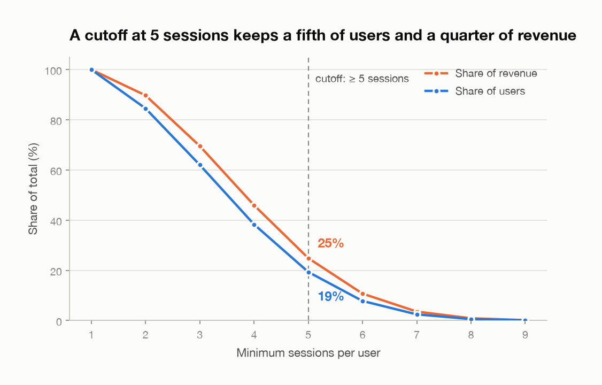
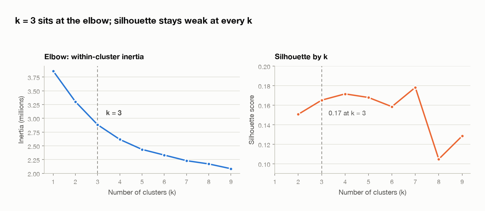
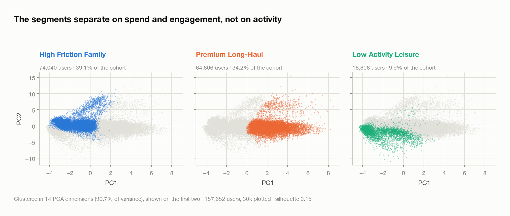

# TravelTide — User Segmentation for a Rewards Program

Behavioural segmentation of TravelTide users to decide **who to invite into a
rewards program and which perk to offer each group**. The objective is not to
raise overall activity, but to raise rewards-program adoption through
data-driven personalisation.

Capstone project of the Masterschool Data Analytics & Data Science bootcamp.

> **Context** — TravelTide is an e-booking platform with strong user growth but
> weak retention. The Head of Marketing wants a personalised perk per user,
> grounded in behaviour rather than intuition.

---

## Results at a glance

Cohort: **189,432 users** with 5 or more sessions — 19% of the user base, but
**25% of cumulative revenue**.

| Segment | Users | % of users | % of revenue | Recommended perk |
|---|---:|---:|---:|---|
| Premium Long-Haul | 64,806 | 34.2% | 47.8% | Free hotel night (bundled) |
| High Value *(top 5% by revenue)* | 8,297 | 4.4% | 23.6% | Cashback / rewards points |
| High-Friction Family | 74,040 | 39.1% | 19.8% | Free checked bag |
| Low-Activity Leisure | 18,806 | 9.9% | 8.9% | Free hotel meal |
| No Purchase | 20,119 | 10.6% | 0.0% | Exclusive discounts |
| Trips Without Revenue | 3,364 | 1.8% | 0.0% | No cancellation fees |

<picture>
  <source media="(prefers-color-scheme: dark)" srcset="reports/figures/segment_value_dark.png">
  
</picture>

Full figures per segment: [`data/processed/segment_summary.csv`](data/processed/segment_summary.csv).

**Key insights**

- Activity alone does not create value: all six segments average ~5.5 sessions,
  yet revenue per user ranges from \$0 to \$14,565.
- The real differentiators are **conversion** and **cancellation** behaviour —
  12% of the cohort books nothing or cancels everything.
- Premium Long-Haul and High Value are 39% of the cohort but **71% of its
  revenue**, so perk generosity should be weighted toward them.

---

## Repository structure

```
.
├── notebooks/
│   ├── 01_exploration_and_cohort_definition.ipynb       # EDA, cutoff analysis
│   ├── 02_feature_engineering_and_segmentation.ipynb    # final pipeline
│   └── 03_full_analysis_end_to_end.ipynb                # complete walkthrough
├── sql/
│   ├── 01_cutoff_criteria_summary.sql
│   ├── 02_sessions_per_user.sql
│   ├── 03_booking_rate.sql
│   ├── 04_cumulative_revenue_per_sessions.sql
│   ├── 05_user_features_v1.sql
│   └── 06_user_features_v2.sql                          # feature table used
├── data/
│   ├── raw/                                             # query exports (not versioned)
│   ├── processed/                                       # outputs; aggregates versioned
│   └── README.md                                        # data dictionary & reproduction
├── reports/
│   ├── executive_summary.pdf
│   ├── detailed_report.pdf
│   └── figures/                                         # README charts, light + dark
├── scripts/
│   └── make_figures.py                                  # regenerates every figure
├── requirements.txt
└── LICENSE
```

Large datasets and the 32 MB slide deck are intentionally excluded from version
control; [`data/README.md`](data/README.md) documents every column and how to
regenerate each file from the SQL queries.

---

## Methodology

### 1. Data preparation
Built a trip-level dataset joining `sessions`, `flights`, `hotels` and `users`,
dropped inconsistent records (negative durations, invalid timestamps, nights
that contradict check-in/check-out), then aggregated to one row per user.

### 2. Cohort definition
Swept the session-count cutoff and compared users retained against revenue
retained. **`total_sessions >= 5`** keeps 19% of users and 25% of cumulative
revenue — the point where the cohort stays small enough to target and still
carries meaningful spend.

<picture>
  <source media="(prefers-color-scheme: dark)" srcset="reports/figures/cohort_cutoff_dark.png">
  
</picture>

### 3. Rule-based segmentation
Three groups are defined by business rules, because their behaviour makes
distance-based clustering meaningless:

- **No Purchase** — sessions but zero bookings
- **Trips Without Revenue** — bookings that generated no revenue (cancellations)
- **High Value** — top 5% by total revenue

### 4. Machine-learning segmentation
The remaining 157,652 users were standardised across all 28 behavioural
features, reduced with **PCA to 14 components** (90.7% of the variance) and
clustered with **KMeans at k = 3**.

<picture>
  <source media="(prefers-color-scheme: dark)" srcset="reports/figures/k_selection_dark.png">
  
</picture>

Two earlier approaches were tried and rejected: three hand-built composite
indices lost too much signal, and **DBSCAN** formed no valid clusters on this
data at any of the representations tested. KMeans on the raw scaled features
scored a silhouette of 0.15 against 0.17 after the PCA step.

The elbow puts k at 3; the silhouette curve is flat and weak across the whole
range, so it neither confirms nor contradicts that choice. The separation these
segments have is modest — worth stating plainly, since the business value here
comes from the segments being *actionable*, not from them being geometrically
tidy.

<picture>
  <source media="(prefers-color-scheme: dark)" srcset="reports/figures/pca_clusters_dark.png">
  
</picture>

### 5. Perk assignment
Each segment was profiled on conversion, cancellation, trip composition and
revenue, and matched to the perk that removes its specific friction or rewards
its specific value driver.

---

## Reproducing the analysis

```bash
git clone https://github.com/adrianmrizo/traveltide-user-segmentation.git
cd traveltide-user-segmentation

python -m venv .venv && source .venv/bin/activate
pip install -r requirements.txt

jupyter lab
```

The notebooks read from `data/`. Generate those inputs first by running the
queries in `sql/` against the TravelTide database — see
[`data/README.md`](data/README.md).

---

## Tech stack

**Python** (pandas, NumPy) · **scikit-learn** (KMeans, PCA, StandardScaler) ·
**Matplotlib / Seaborn** · **PostgreSQL** · **Tableau** (presentation visuals)

---

## Deliverables

- [`reports/executive_summary.pdf`](reports/executive_summary.pdf) — one-page summary for stakeholders
- [`reports/detailed_report.pdf`](reports/detailed_report.pdf) — full methodology and segment profiles
- `data/processed/user_segments.csv` — `user_id` → `segment_label`, the hand-off to marketing
- [`data/processed/segment_summary.csv`](data/processed/segment_summary.csv) — aggregated segment profiles

---

## Author

**Adrián Marroquín Rizo** — Data Analyst
Masterschool Data Analytics & Data Science

Licensed under the [MIT License](LICENSE).
